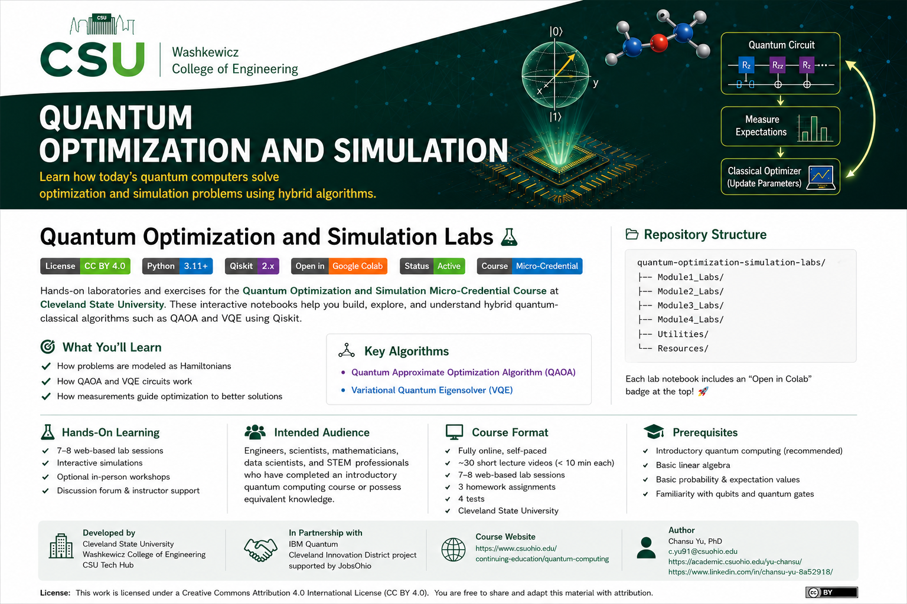

<p align="center">
  
</p>

# Quantum Optimization and Simulation Labs

[](LICENSE)


Hands-on laboratories and exercises for the **Quantum Optimization and Simulation** Micro-Credential Course at **Cleveland State University**.

This repository accompanies the online micro-credential course and provides interactive Jupyter and Google Colab notebooks that reinforce concepts presented in the lecture videos.

Unlike many introductory tutorials that simply demonstrate software libraries, these laboratories emphasize **understanding how variational quantum algorithms work internally**, including how optimization problems and molecular systems are translated into Hamiltonians, quantum circuits, measurements, and classical optimization.

---

# Repository Structure

```text
quantum-optimization-simulation-labs/

├── README.md
├── LICENSE
├── requirements.txt
│
├── Module1_Labs/
│   ├── Lab01 Python, Colab, and Qiskit Quick Start
│
├── Module2_Labs/
│   ├── Lab02 Complete 5-Node Max-Cut QAOA
│   ├── Lab03 QAOA: Ideal Simulator, Noise, and Real Hardware
│   ├── Optional Lab: Max-Cut to Portfolio Optimization
│   ├── Assignment 1: QAOA with 20-Node Max-Cut
│
├── Module3_Labs/
│   ├── Lab04 Preparing the H₂ Configuration Mix
│
├── Module4_Labs/
│   ├── Lab05 Complete VQE for the H₂ Ground-State Energy
│   ├── Lab06 H₂ Bond-Length Curve, Noise, and Optional Hardware
│   ├── Lab06(Extra) Assignment 2: VQE for the BeH₂ (beryllium hydride) Ground-State Energy
│
├── Utilities/
│
├── Resources/
│
└── images/
```

---

# Course Components

The micro-credential consists of approximately

| Component | Quantity |
|-----------|---------:|
| 🎥 Short lecture videos | 22 |
| 💻 Web-based laboratories | 6 |
| 📝 Homework assignments | 2 |
| ✅ Tests | 4 |

---

# Learning Objectives

After completing these laboratories, learners should be able to

- Explain the principles of hybrid variational quantum algorithms.
- Describe how QAOA solves combinatorial optimization problems.
- Formulate optimization and simulation problems using Hamiltonians.
- Describe how VQE estimates molecular ground-state energies.
- Interpret quantum circuit measurements and optimization results.
- Identify potential applications of variational quantum algorithms in their own discipline.

---

# Example Applications

## Quantum Optimization (QAOA)

- Max-Cut
- Portfolio Optimization
- Vehicle Routing and Logistics
- Knapsack and related combinatorial optimization problems

## Quantum Simulation (VQE)

- Hydrogen (H₂) ground-state energy
- Molecular energy estimation
- Chemical and materials design
- Vibrational simulation

---

# Using the Labs

Every notebook includes an **Open in Colab** badge.

Simply

1. Open the notebook in Google Colab.
2. Save a copy to your own Google Drive.
3. Complete the exercises.
4. Experiment with parameters.
5. Save your completed notebook for future reference.

No local installation is required for most laboratories.

---

# Software Requirements

The laboratories are developed using

- Python 3.11+
- Qiskit 2.x
- NumPy
- SciPy
- Matplotlib
- Google Colab / Jupyter Notebook

Additional packages may be required for selected laboratories.

---

# Notes for Students

Most notebooks accompany the lecture videos.

To encourage active learning, many notebooks intentionally contain partially completed code or conceptual questions for you to complete while following the lectures.

Optional challenge exercises are included for learners wishing to explore topics further.

---

# Repository Highlights

- Interactive Google Colab notebooks
- Short, focused laboratory exercises
- Step-by-step implementation
- Practical engineering and scientific examples
- QAOA and VQE explained from first principles
- Suitable for self-paced learning

---

# Citation

If you use these materials in teaching, research, or curriculum development, please cite both this repository and the course webpage.

**Quantum Computing Micro-Credential**

https://www.csuohio.edu/continuing-education/quantum-computing

---

# Acknowledgments

Developed at

- Cleveland State University
- Washkewicz College of Engineering
- CSU Tech Hub

In collaboration with

- IBM Quantum
- Cleveland Innovation District project supported by JobsOhio

---

# Author

**Chansu Yu, Ph.D.**

Professor

Department of Electrical and Computer Engineering

Cleveland State University

📧 c.yu91@csuohio.edu

🌐 https://academic.csuohio.edu/yu-chansu/

💼 https://www.linkedin.com/in/chansu-yu-8a52918/

🎓 Course Website

https://www.csuohio.edu/continuing-education/quantum-computing

---

# License

Unless otherwise noted, all instructional materials in this repository are licensed under the **Creative Commons Attribution 4.0 International (CC BY 4.0)** License.

You are free to share, adapt, and redistribute these materials with appropriate attribution.

---

<p align="center">

**Happy Quantum Learning!**

</p>
